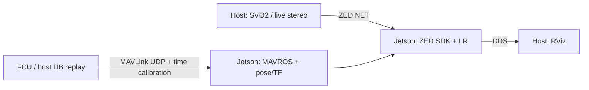

# Landfill Rover ROS 2

The distributed architecture is **host source → Jetson backend → host RViz**.
The [always-on live backend](docs/always-on-live.md) receives ZED NET and MAVLink,
uses wall time, and runs pose/TF, terrain and segmentation without a Jetson DB
or `/clock`. The host simulator runs Python independently of ROS. Prediction
is disabled in this mode; the two recorded-time replay paths remain available.



The new `headless_live.launch.py` obtains pose from received MAVROS GPS/attitude,
sets a fixed origin from the first valid GPS fix and survives host restarts.
Camera/FCU hardware and the SVO simulator use that same backend command.
See [live acceptance results](docs/always-on-live-validation.md).

The recorded-time replay baseline obtains pose from received MAVROS GPS/attitude.
The Jetson DB process supplies the fixed ENU origin and future reference path;
it does not publish pose or TF. The original `stream_svo_mode:=false` launch
retains its ZED tracking behavior.
With the existing ROS source, only the host SVO source publishes `/clock`.
An optional [standalone Python source](tools/host_replay/README.md) sends NET,
MAVLink and UDP clock without ROS; `/replay_clock_bridge` on Jetson is then
the sole ROS clock publisher. Network addresses and ports are passed explicitly
on the command line. The original ROS source remains available for comparison.
See [standalone validation](docs/standalone-replay-validation.md) for the real
NET/MAVLink and source-restart checks.

Use the [three-terminal run guide](docs/mavros-replay.md) and
[deployment/network checklist](docs/distributed-rviz.md). The only LR pipeline
entry points are `headless_live.launch.py` (wall time) or
`headless_zed_cam.launch.py` (baseline replay) on Jetson and
`rviz_zed_cam.launch.py` on the host. SDK 5.4.1 supports sequential NET playback;
pause/seek remains outside acceptance. See the [migration report](docs/net-mavros-migration.md).

## Canonical prediction pipeline

Prediction is built as normal ROS 2 packages under `src/lr-ros2`.

| Package | Responsibility |
|---|---|
| `safety_perception_msgs` | Canonical typed ROS messages |
| `prediction_core` | ROS-independent collision and rollover physics |
| `prediction_ros` | Runtime node that publishes raw safety evidence |
| `lr_prediction_bridge` | Adapters from LR pipeline messages to canonical messages |
| `lr_path_prediction` | Diagnostic and RViz presentation of canonical output |

The recorded-time replay backend runs `mavlink_ground_truth`, `mavros_pose`, segmentation,
box estimation, terrain geometry, the prediction bridge, prediction runtime
and visualization publisher. MAVROS, ZED and its static state publisher run
on Jetson; RViz and the recording source run on the host.

One `prediction_bridge_node` converts the four inputs below. Geometry is
sampled directly from the reference trajectory in that process.

The adapters perform these conversions:

| LR input | Canonical topic |
|---|---|
| `/lr/future_path/ground_truth` (`nav_msgs/Path`) | `/trajectory` (`safety_perception_msgs/Trajectory`) |
| `/terrain_geometry/grid_map` (`grid_map_msgs/GridMap`) | `/geometry` (`safety_perception_msgs/GeometryArray`) |
| `/segmentation/tracked_footprints` (`safety_perception_msgs/TrackedObjectArray`) | `/tracked_objects` (`safety_perception_msgs/TrackedObjectArray`) |
| `/lr/mavlink/pose` (`geometry_msgs/PoseStamped`) | `/rover/state` (`safety_perception_msgs/RoverState`), dynamic only |

The visualizer publishes `/lr/path_prediction/reference_path` only after the
trajectory, geometry, and prediction for the same cycle are available. This
cycle-matched path shares its timestamp and displayed XYZ points with
`/lr/path_prediction/markers`; use it instead of the continuously updating raw
future path when comparing prediction output in RViz.

For up to 20 future steps, the canonical engine computes discrete oriented
footprint collision candidates, terrain-relative roll and pitch, Static SSM,
and normalized Static SSM. The dynamic profile additionally computes edge
Stability Moments and point-mass ZMP when acceleration is available.

`/predict_output` is raw safety evidence. It intentionally does not assign
risk severity, apply Stop/Go policy, or command the rover. The visualization
node derives only UI warnings from that evidence:

- gray points when no warning is available;
- a slope label when terrain geometry exists;
- one large triangle/`!` above the nearest actual footprint intersection;
- terrain-normal arrows;
- orange/red points for configured slope display thresholds; only the nearest
  actual intersection is highlighted in magenta.

By default, visualization stops at the first step outside valid terrain
coverage, while diagnostics continue to report those steps as TERRAIN UNKNOWN.
The box estimator has
Kalman tracking with persistent numeric IDs until its tracker resets. Its
`Detection3DArray` output has no object velocity, so `velocity_valid` stays false
and objects are treated as static within each prediction cycle. Class/score
metadata is currently `unknown`/1.0 in that box output, not the YOLO class score.

The raw engine also reports objects within `collision_margin_m` as collision
candidates. A positive-clearance candidate does not add `!` or change the RViz
color; it remains available in `/predict_output` for a downstream Decision
Node.

## Building

Both `zed-dev` containers use ROS 2 Humble, ZED SDK 5.4.1, host networking,
`ROS_DOMAIN_ID=42` and `ROS_LOCALHOST_ONLY=0`. Install MAVROS/GeographicLib on
both machines and pymavlink on the host as described in the run guide.
Stop active launches before building. On the host:

```bash
source /opt/ros/humble/setup.bash
colcon build --symlink-install --packages-up-to lr_mavlink_replay lr_display_rviz2
source install/setup.bash
```

Preview and sync source according to [AGENTS.md](AGENTS.md), then build on
Jetson with `colcon build --symlink-install --packages-up-to lr_display_rviz2`.
The SVO stays on the host; segmentation models stay on Jetson. A matching DB
is needed on the host for telemetry. Only the recorded-time replay backend
also needs the DB on Jetson for reference ground truth.

## Rover configuration

The bundled rover values are references only. Before field use, replace them
with measured/CAD mass, body dimensions, support polygon, center of mass,
ground clearance, and collision margin. Supply the resulting file with:

```bash
prediction_rover_config:=/path/to/rover.yaml
```

`prediction_params_file` configures only diagnostic/RViz presentation, such as
slope thresholds and marker dimensions. It does not configure the physics
model.

## Replay configuration and synchronization

The original full command remains valid. To run without the RViz process, add
`start_rviz:=false`. Overlays, heatmaps, and markers are generated only when
subscribed; masks, boxes, GridMap and raw prediction remain available.

| Launch argument | Owns |
|---|---|
| `bridge_params_file` | Bridge input/output topics and trajectory sampling |
| `prediction_runtime_params_file` | Runtime input age limits and readiness |
| `prediction_params_file` | Diagnostics/RViz presentation |
| `prediction_rover_config` | Rover physics parameters |

YAML is loaded first; explicit launch topic/frame/profile/time settings override
it. The display launch includes the same `lr_path_prediction` launch used for
standalone prediction. The bridge YAML uses the `prediction_bridge_node` section
and role prefixes (`trajectory.*`, `geometry.*`, `tracked_objects.*`,
`rover_state.*`); old adapter sections remain for compatibility.

Default replay age limits relative to the trajectory timestamp are objects
0.5 s, GridMap 2 s and rover state 0.25 s. An empty object batch retains its
measurement timestamp and expires too. Future measurements cannot complete a
cycle. `/geometry.header.stamp` is the GridMap sensor timestamp;
`source_trajectory_stamp` and `source_trajectory_id` identify its trajectory.
Set the bridge `geometry.max_geometry_age_sec` and runtime
`max_geometry_age_sec` together when changing terrain age limits.

Path, pose and GridMap frames must match `expected_frame_id`; the compatibility
`force_frame_id_map` parameter no longer relabels coordinates. Boxes in other
frames use timestamped TF, retried without blocking up to `tf_timeout_sec`.
Missing/invalid TF or malformed detections do not become an empty observation.

Mask/depth synchronization retains at most 30 messages per stream and 1 s of
source time (`sync_buffer.max_samples`, `sync_buffer.max_age_sec`), pairing the
nearest available timestamps within `sync_tolerance_sec` (50 ms). Each message
is consumed at most once. Restarting replay at an earlier recording time or changing the time source clears
buffers, terrain, tracking, bridge and runtime caches. Bridge trajectory IDs
continue increasing after rewind. Pausing leaves the simulation clock still.
Reset clears presentation without emitting a synthetic empty objects batch;
prediction waits for a new measured observation.

`/prediction/diagnostics` reports missing, future or stale runtime inputs and
callback time. Perception timing and mask/depth pairing counters are on
`/diagnostics`. Prediction visualization clears warnings while runtime reports
unavailable evidence or an expired trajectory.

## Validation and replay measurement

Use the timestamp/units and camera-TF ownership tools in the run guide:

```bash
ros2 run lr_mavros_bridge verify_tf_owner
python3 src/lr-ros2/lr-mavlink-replay/tools/verify_telemetry.py \
  --db mavlink/session_20260710_0924_mavlink/session_mavlink.db --duration 30
python3 src/lr-ros2/lr-zed-stream/tools/verify_net_replay.py \
  --duration 30 --require-prediction
```

[Transport acceptance](docs/mavros-replay-validation.md) records measured
conversion errors, causal pose coverage, network load, loss and restart
behavior. These checks verify transport and pipeline publication; they do not
establish localization accuracy or prediction quality.

## Main outputs

```text
/lr/mavlink/pose
/lr/future_path/ground_truth
/segmentation/overlay
/segmentation/boxes_3d
/segmentation/tracked_footprints
/terrain_geometry/grid_map
/terrain_geometry/markers
/trajectory
/geometry
/tracked_objects
/rover/state                  # dynamic profile
/predict_output               # canonical raw safety evidence
/lr/path_prediction/steps     # DiagnosticArray presentation
/lr/path_prediction/markers   # RViz MarkerArray presentation
```

`/lr/future_path/ground_truth` is a recorded future trajectory for offline
visualization and evaluation. It is not a planned path and must not be used to
control the rover.
